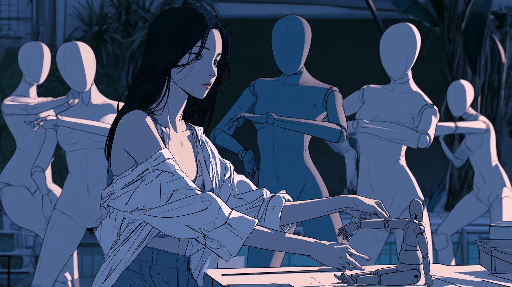
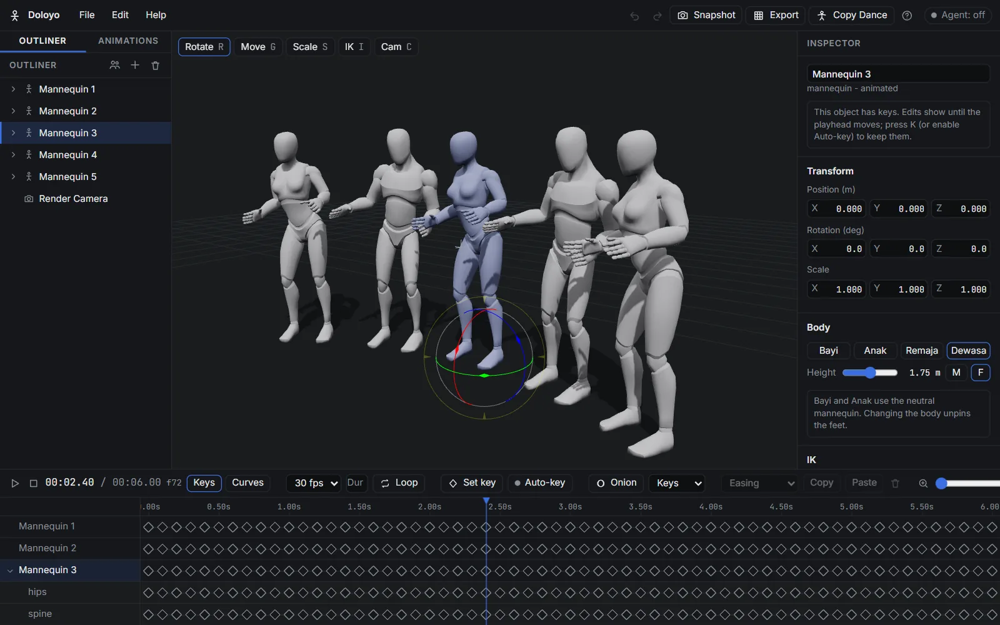
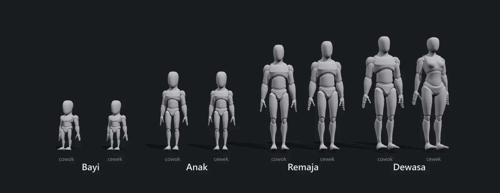
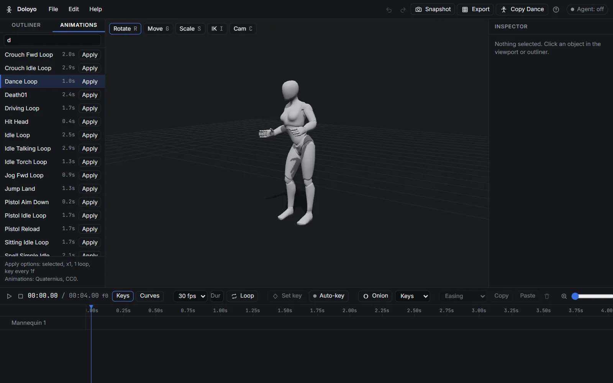
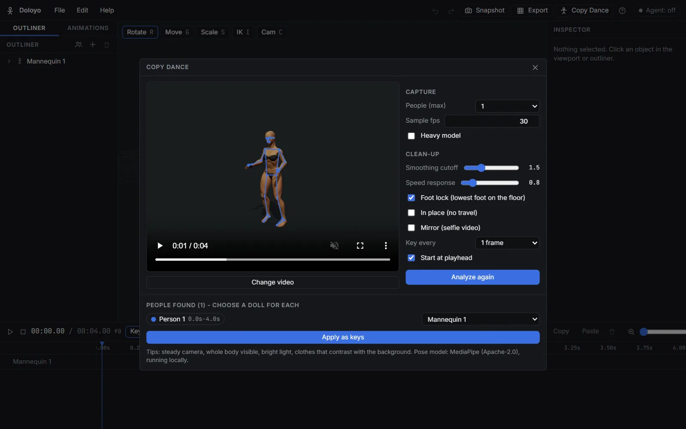
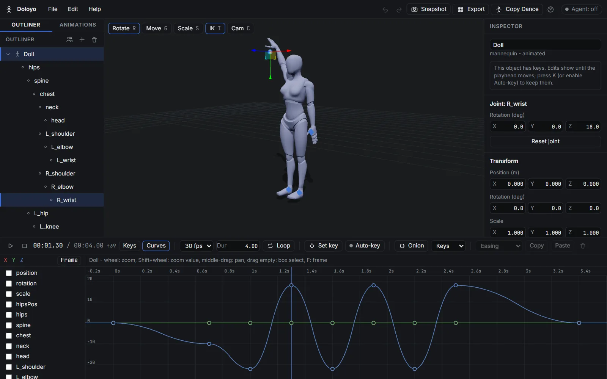
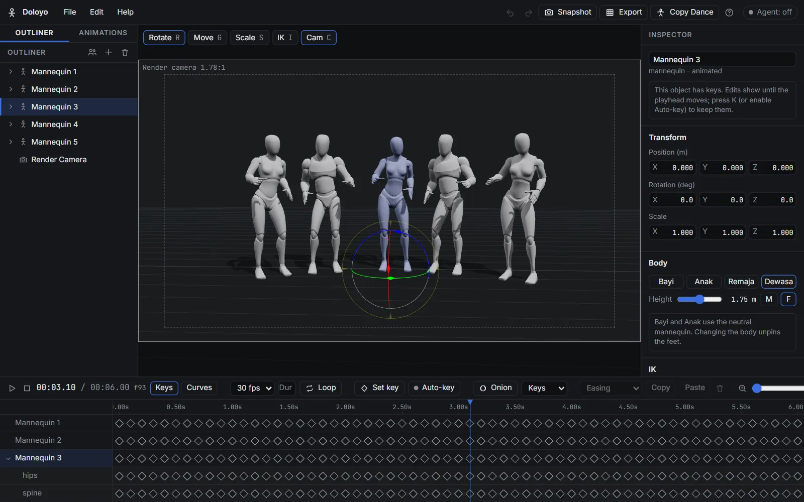
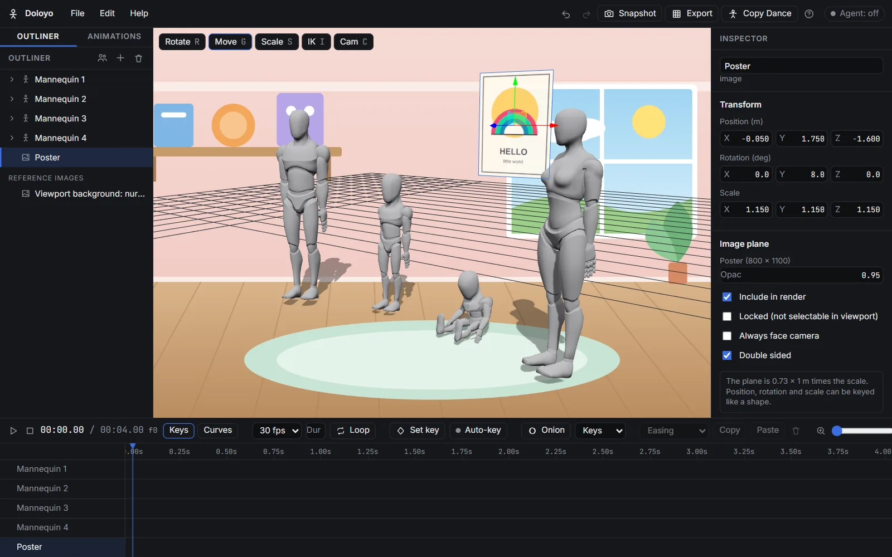
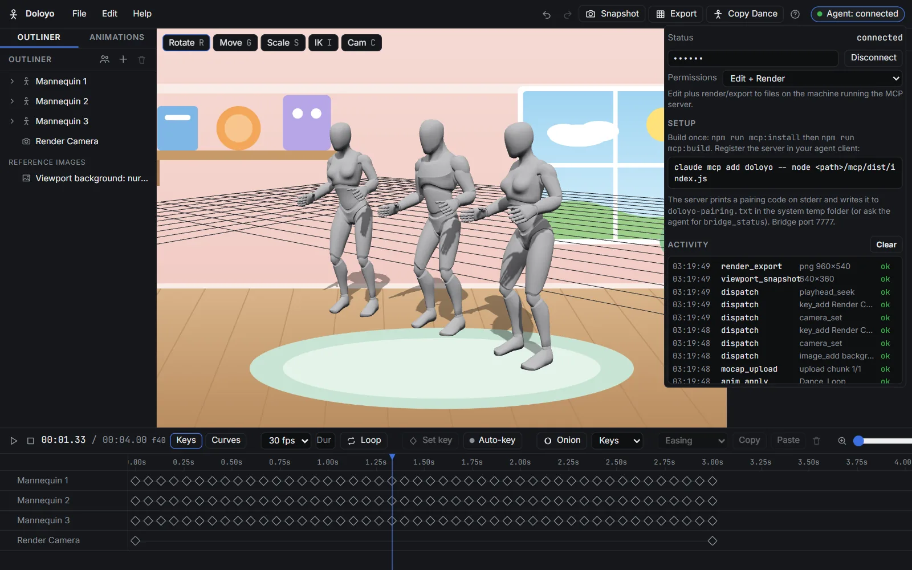

<p align="center">
  
</p>

# Doloyo

**Your floppy little motion studio.** Atur pose manekin 3D, bikin keyframe, salin tarian dari video, lalu ekspor hasilnya. Berjalan di browser, dan agent AI bisa mengendalikannya lewat server MCP lokal.

[English](README.md) | Bahasa Indonesia

[](https://github.com/dkfadhila/doloyo/actions/workflows/ci.yml)
[](LICENSE)

<p align="center">
  
</p>

## Coba sekarang

- **Di browser:** https://doloyo.vercel.app. Tidak perlu instal apa pun; render memakai GPU kamu sendiri dan proyek tersimpan di browser.
- **Jalankan lokal** (bisa sepenuhnya offline):

```
git clone https://github.com/dkfadhila/doloyo
cd doloyo
npm run setup        # npm install, build server MCP, unduh model pose
npm start            # http://localhost:5173
```

Langkah pertama: klik sebuah sendi, seret cincinnya untuk memutar (R), geser playhead, atur pose lagi, tekan K untuk menyimpan key, Space untuk memutar. Menu Help > Examples memuat proyek contoh dan Help > Tour memandu keliling app.

## Fitur

### Posing dan keyframe

*Editor (tangkapan layar di atas): outliner di kiri, viewport dengan gizmo putar pada boneka terpilih, inspector di kanan, dan timeline keyframe di bawah. Setiap perubahan adalah perintah yang bisa di-undo, baik dari kamu maupun dari agent.*

- Manekin prosedural dengan 17 sendi dan batas sendi, plus kubus, bola, dan silinder; banyak objek dalam satu scene.
- Posing FK dengan gizmo, mirror, pose library, onion skin, key per sendi dengan easing bernama atau bezier, seleksi kotak dan edit banyak key, loop, fps, dan durasi.
- Preset scene untuk duo, trio, grup 5 orang, dan keluarga (2 dewasa, anak, bayi), default campur cowok dan cewek.

### Karakter dan ukuran tubuh



*Delapan varian tubuh bawaan: Bayi, Anak, Remaja, dan Dewasa, masing-masing cowok dan cewek. Anak-anak adalah manekin seni yang netral; yang berubah hanya proporsinya. IK, pin kaki, dan export mengikuti ukuran tubuh.*

- Ukuran tubuh dengan slider tinggi dan pose bayi (duduk, merangkak, berdiri sambil pegangan) yang menjaga tubuh tetap di lantai.
- Manekin Quaternius (CC0) dan art doll prosedural, atau file `.glb` / `.vrm` milikmu dengan pemetaan tulang. Setiap karakter hanyalah tampilan lain dari pose 17 sendi yang sama.

### Library animasi



*Tab Animations berisi 86 klip CC0. Arahkan kursor atau klik klip untuk melihat preview pada boneka terpilih; Apply mem-bake-nya jadi key dalam satu langkah undo.*

- Opsi target, kecepatan, loop, mirror, dan in-place; klip bekerja di semua karakter dan ukuran tubuh.

### Copy Dance: video jadi animasi



*Copy Dance melacak orang di video dengan MediaPipe Pose Landmarker lalu mengubahnya jadi key. Kerangka biru adalah pose hasil lacak; video sumber di sini dirender dari Doloyo sendiri.*

- Sampai 4 orang, smoothing, foot lock, in-place, dan mirror. Semuanya berjalan di browser kamu; video tidak pernah diunggah.

### IK, pin kaki, dan kurva



*Handle IK di pergelangan tangan dan kaki (biru) memungkinkan kamu menyeret anggota badan ke suatu titik. Di bawahnya, curve editor mengedit channel sendi dengan handle bezier.*

- IK dua tulang dengan kontrol pole, pin kaki yang mencegah kaki tergelincir saat pinggul bergerak, dan Bake pins untuk mengubah hasilnya jadi key biasa.

### Kamera render



*Melihat lewat kamera render yang beranimasi (C). Tepi yang digelapkan ada di luar bingkai dan persegi putus-putus adalah area aman 90% untuk rasio export.*

- PNG (720p sampai 4K, transparan), PNG sequence (zip), WebM dan MP4 lewat WebCodecs, GLB dan BVH dengan animasi ter-bake untuk Blender, Unity, atau Unreal.

### Gambar referensi



*Gambar kamar dipakai sebagai background viewport dan sebuah poster ditambahkan sebagai image plane. Plane yang terpilih punya gizmo dan opsinya sendiri di inspector.*

- Tiga mode, seperti di Blender: **viewport background** menempel ke layar (fit, fill, atau center, plus opasitas), **image plane** di dalam scene 3D (geser, putar, skala, keyframe, opasitas, double sided, lock, selalu menghadap kamera), dan **camera background** yang terkunci pada bingkai kamera render.
- Tambahkan lewat File > Add reference image, menu + di outliner, atau seret file ke viewport (png, jpg, webp, gif frame pertama, svg).
- "Include in render" menentukan apakah gambar ikut di snapshot, export, dan GLB (image plane menjadi quad bertekstur). Gambar disimpan di browser kamu; file proyek hanya menyimpan id-nya, dan opsi "Embed images" saat Save menyisipkan gambar sampai 2 MB ke dalam file.

### Kontrol agent



*Klien MCP yang terhubung lewat panel Agent (pairing code disembunyikan). Log aktivitas mencatat apa yang dikerjakan agent; tab menampilkannya langsung dan kamu bisa meng-undo-nya.*

- Server MCP menyediakan perintah yang sama dengan UI (scene, objek, sendi, key, IK, kamera, animasi, Copy Dance, gambar referensi, export) dengan izin read-only, edit, atau edit + render.

## Kontrol agent (MCP)

Agent bicara MCP lewat stdio ke `doloyo-mcp`, yang menjalankan bridge WebSocket di `127.0.0.1:7777`. Tab Doloyo terhubung ke bridge itu dengan pairing code 6 digit. Paket npm **belum dipublikasikan**, jadi server dijalankan dari hasil clone (`npm run setup` sudah membangunnya):

```
claude mcp add doloyo -- node <path>/mcp/dist/index.js
```

Claude Desktop (`claude_desktop_config.json`) atau klien MCP stdio lain:

```json
{
  "mcpServers": {
    "doloyo": {
      "command": "node",
      "args": ["<path>/mcp/dist/index.js"]
    }
  }
}
```

Untuk mengendalikan app di situs https://doloyo.vercel.app, tambahkan `--allow-hosted` pada argumen. Halaman situs lalu terhubung ke `ws://127.0.0.1:7777` di komputer kamu; Chrome dan Edge bisa menampilkan prompt Private Network Access, dan Safari memblokir koneksi ini (pakai app lokal di Safari).

Setelah itu buka app, klik pil **Agent** (kanan atas), masukkan kode yang dicetak server (atau minta agent membaca `bridge_status`), lalu pilih mode izin.

- [AGENTS.md](AGENTS.md): tutorial langkah demi langkah untuk agent dengan contoh lengkap (melambai, dance crew dengan gerakan kamera, adegan iklan bayi, Copy Dance, IK). Ditulis dalam bahasa Inggris.
- [docs/AGENT.md](docs/AGENT.md): referensi lengkap tool dan perintah.
- [mcp/README.md](mcp/README.md): opsi server, model keamanan, dan troubleshooting.

### Skill untuk agent

Folder [skills/](skills/README.md) berisi skill bawaan yang mengajari agent cara bikin animasi yang bagus, bukan cuma cara memanggil tool: `doloyo-director` (dari beat sheet sampai render final, dengan putaran kritik), `doloyo-fight-choreography` (adegan laga, timing klip yang sudah diukur), `doloyo-camera` (bahasa kamera dan framing 9:16 untuk kamera render) dan `doloyo-keyframe-motion` (easing, spacing, menyambung klip dengan mulus). Untuk Claude Code, salin ke `~/.claude/skills/`; agent MCP lain bisa membacanya lewat `guide_read {"skill": "<nama>"}`. Ditulis dalam bahasa Inggris.
- [docs/GUIDE.md](docs/GUIDE.md): panduan pemakaian app (bahasa Indonesia; juga ada di dalam app lewat tombol bantuan).

## Privasi

Semuanya berjalan lokal. Proyek disimpan di browser kamu (IndexedDB) atau di file yang kamu simpan. Video untuk Copy Dance, gambar referensi, dan karakter hasil import tidak pernah diunggah. Satu-satunya permintaan jaringan adalah halaman beserta aset statisnya, Google Fonts, dan, kalau app di-deploy tanpa model pose bawaan, runtime MediaPipe yang di-pin dari jsDelivr dan file model dari Google storage (dialog Copy Dance memberi tahu). Bridge MCP hanya mengikat 127.0.0.1 dan hanya menerima origin browser yang masuk daftar izin plus pairing code. Tanpa analitik.

## Tech stack

TypeScript, React 18, Vite, three.js dengan React Three Fiber dan drei, zustand, three-vrm, MediaPipe Tasks Vision (pose), WebCodecs dengan mp4-muxer dan webm-muxer, fflate, dan SDK Model Context Protocol untuk server agent. State proyek adalah JSON biasa yang hanya diubah lewat perintah yang bisa dibalik (`src/core`); karena itu undo, agent, dan tes jadi sederhana. Vitest mencakup core, retargeting, export, bridge MCP (smoke test), dan tutorial di AGENTS.md.

```
npm test                       # vitest
npm run build                  # tsc --noEmit + vite build
npm run smoke --prefix mcp     # smoke test bridge MCP
npm run examples               # buat ulang public/examples/*.mdoll.json dari API perintah
```

Hosting statis: `VITE_BASE=/sub/path/ npm run build` menghasilkan `dist/` yang bebas host. Konfigurasi untuk Vercel, Netlify, dan Cloudflare Pages tersedia. Lihat [CONTRIBUTING.md](CONTRIBUTING.md).

File proyek tetap berekstensi `.mdoll.json` (sebelum 0.6 Doloyo bernama Motion Doll Studio); file lama, proyek tersimpan, dan karakter hasil import tetap terbawa.

## Roadmap

Selesai: posing dan keyframe, bridge agent, export, karakter dan retargeting, library animasi, Copy Dance, IK, curve editor, kamera render, GLB dan BVH, ukuran tubuh, gambar referensi. Berikutnya, menunggu keputusan: publikasi `doloyo-mcp` ke npm, tag 1.0. Ide setelah itu: IK tulang belakang dan multi-tulang, pelacakan wajah dan tangan, lebih banyak format import.

## Kredit dan lisensi

Doloyo berlisensi MIT, lihat [LICENSE](LICENSE). Karakter dan animasi oleh [Quaternius](https://quaternius.com) (CC0). Model pose: MediaPipe (Apache-2.0). Dibangun di atas three.js, React Three Fiber, drei, three-vrm, fflate, webm-muxer, mp4-muxer, dan SDK MCP (semuanya MIT). Daftar lengkap: [THIRD_PARTY_NOTICES.md](THIRD_PARTY_NOTICES.md) dan [public/assets/CREDITS.md](public/assets/CREDITS.md). Perubahan: [CHANGELOG.md](CHANGELOG.md).

## Kenapa Doloyo?

Jawaban jujur: nggak ada alasan serius. Doloyo itu proyek iseng yang dibuat buat senang-senang, dan memang kelihatan begitu.

Doloyo bukan alat terbaik untuk apa pun. Kalau butuh kerja animasi yang serius, pakai software 3D atau animasi yang beneran; jauh lebih lengkap dan jauh lebih rapi. Doloyo cocok kalau kamu cuma mau naruh beberapa boneka loyo di layar, bikin mereka joget, dan mungkin nyuruh agent AI ngatur-ngatur mereka, semuanya di satu tab browser.

Yang kamu dapat:

- Jalan di browser, tidak perlu instal untuk app web, render di komputer sendiri.
- Keyframe, IK, curve editor, library animasi, dan Copy Dance dari video.
- Server MCP bawaan supaya agent bisa pose dan animasi buat kamu.

Yang juga kamu dapat (bagian yang kurang enak):

- Bukan suite 3D beneran: tanpa modeling, tanpa sculpting, tanpa renderer canggih.
- Satu rig humanoid 17 sendi: tanpa jari, tanpa wajah.
- Copy Dance kualitasnya setara webcam: gerakan cepat, anggota tubuh yang tertutup, dan kamera yang bergerak bikin bingung, jadi siap-siap merapikan.
- Tanpa fisika. Kaki kadang meluncur. Boneka bisa saling tembus.
- Koneksi agent dari versi web tidak jalan di Safari.
- Karakter hasil import dan gambar referensi tetap tinggal di browser yang mengimpornya.
- Kebanyakan baru dites di Chrome oleh satu orang. Pasti ada bug, tolong laporkan.

Kalau masih kedengaran seru, selamat datang. Kalau tidak, santai saja.
