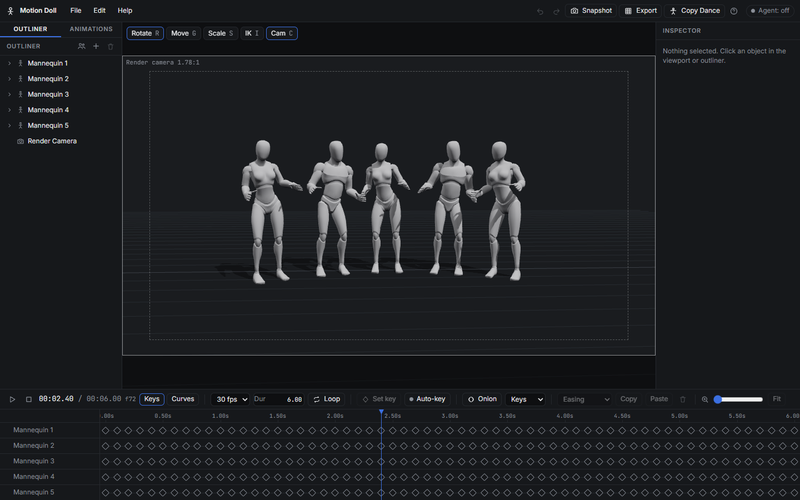

# Motion Doll Studio

Pose a 3D mannequin, keyframe it, and export the result. It runs in your browser, and AI agents can drive it through a local MCP server.



## Two ways to use it

**Install from GitHub (works fully offline).**

```
git clone https://github.com/<owner>/motion-doll-studio
cd motion-doll-studio
npm run setup        # npm install, build the MCP server, download the pose model
npm start            # http://localhost:5173
```

**Use it on the web (static site, nothing to install for the app).** Open the hosted site; rendering happens on your own GPU and projects live in your browser's IndexedDB. To let an agent drive it, run one command on your machine:

```
npx motion-doll-mcp --allow-hosted
```

The hosted page then connects to `ws://127.0.0.1:7777` on your computer. Chrome and Edge may show a Private Network Access prompt; Safari blocks the connection, so use the local install there. See [Agent setup](#agent-setup).

The hosted URL and the npm package are not published yet; until then use the GitHub install.

## Quick start

1. Click a joint to select it, drag the ring to rotate (R), or type degrees in the Inspector.
2. Move the playhead, pose again, press K to set a key. Space plays.
3. Open Help > Examples for ready projects, Help > Tour for a 5-step walkthrough.
4. Export from the top bar: PNG, PNG sequence, WebM, MP4, GLB or BVH.

## Features

**Posing and animation**
- Procedural mannequin with a 17-joint rig and joint limits, plus cube, sphere and cylinder; many objects per scene, presets for duo, trio and group of 5.
- FK posing with a gizmo, two-bone IK on wrists and ankles, foot pins, mirror, pose library, onion skin.
- Timeline with per-joint keys, per-key easing (named or bezier), curve editor, marquee and multi-key edit, copy and paste, loop, fps and duration.
- Undo and redo for everything, including agent edits (every change is an invertible command).

**Characters and motion sources**
- Quaternius mannequins and superheroes (CC0), your own `.glb` or `.vrm` with bone mapping, retargeted from the one 17-joint pose.
- Animation library: 86 CC0 clips, applied as keys in one undo step (target, speed, loops, mirror, in place).
- Copy Dance: video to keys with MediaPipe Pose Landmarker, up to 4 people, smoothing and foot lock. Runs locally.

**Camera and export**
- Animated render camera with look-through and safe frame.
- PNG (720p to 4K, transparent), PNG sequence (zip), WebM and MP4 through WebCodecs, GLB and BVH with baked animation for Blender, Unity or Unreal.

**Agents**
- MCP server with the same commands as the UI (scene, objects, joints, keys, IK, camera, animations, Copy Dance, export), read-only, edit or edit + render permissions, activity log.

## Agent setup

The agent talks MCP over stdio to `motion-doll-mcp`, which runs a WebSocket bridge on `127.0.0.1:7777`. The Studio tab connects to that bridge with a 6-digit pairing code.

Claude Code:

```
claude mcp add motion-doll -- node /path/to/motion-doll-studio/mcp/dist/index.js
# or, once the package is published:
claude mcp add motion-doll -- npx -y motion-doll-mcp
```

Claude Desktop (`claude_desktop_config.json`):

```json
{
  "mcpServers": {
    "motion-doll": {
      "command": "node",
      "args": ["/path/to/motion-doll-studio/mcp/dist/index.js"]
    }
  }
}
```

Then open the app, click the Agent pill (top right), enter the code the server prints (or ask the agent for `bridge_status`), and choose a permission mode. For a hosted deployment add its origin with `--origin https://your.site`. Details: [mcp/README.md](mcp/README.md), tools and workflow: [docs/AGENT.md](docs/AGENT.md).

## Privacy

Everything runs locally. Projects are stored in your browser (IndexedDB) or in files you save. Videos used for Copy Dance and imported characters are never uploaded. The only network requests are the page and its static assets, Google Fonts, and, when the app was deployed without the bundled pose model, the pinned MediaPipe runtime from jsDelivr and the model file from Google storage (the dialog says so). The MCP bridge binds to 127.0.0.1 and only accepts allow-listed browser origins plus the pairing code. No analytics.

## Development

```
npm test                       # vitest
npm run build                  # tsc --noEmit + vite build (prebuild fetches the pose model if missing)
npm run smoke --prefix mcp     # MCP bridge smoke test
npm run examples               # regenerate public/examples/*.mdoll.json from the command API
```

Static hosting: `VITE_BASE=/sub/path/ npm run build` produces a host-agnostic `dist/`. Configs for Vercel, Netlify and Cloudflare Pages are included, plus GitHub Actions CI and a manual Pages workflow; no cross-origin isolation headers are needed. On Windows Git Bash prefix with `MSYS_NO_PATHCONV=1`. See [CONTRIBUTING.md](CONTRIBUTING.md).

Layout: `src/core` (pure TypeScript: rig, interpolation, IK, commands), `src/store.ts` (the only way to mutate the project is `dispatch(cmd)`), `src/three` (React Three Fiber scene), `src/retarget`, `src/anim`, `src/mocap`, `src/render`, `src/agent`, `src/ui`, `mcp` (separate package), `docs`, `scripts`.

Known limitations: characters with different proportions can slide or float (foot pins help); Copy Dance depth is estimated, webcam-mocap quality; IK is a two-bone solver; glTF export cannot animate camera FOV; VRM spring bones and expressions are not simulated.

## Roadmap

Done: posing and keyframes, agent bridge, export, characters and retargeting, animation library, Copy Dance, IK, curve editor, render camera, GLB and BVH (phases 1 to 3), and release preparation (phase 4). Next, pending decisions: choose a host and domain, publish `motion-doll-mcp` to npm, tag 1.0. Ideas after that: spine and multi-bone IK, face and hand tracking, more import formats.

## Credits and license

MIT, see [LICENSE](LICENSE). Characters and animations by [Quaternius](https://quaternius.com) (CC0). Pose model: MediaPipe (Apache-2.0). Built on three.js, React Three Fiber, drei, three-vrm, fflate, webm-muxer, mp4-muxer and the MCP SDK (all MIT). Full list: [THIRD_PARTY_NOTICES.md](THIRD_PARTY_NOTICES.md) and [public/assets/CREDITS.md](public/assets/CREDITS.md). Changes: [CHANGELOG.md](CHANGELOG.md).
