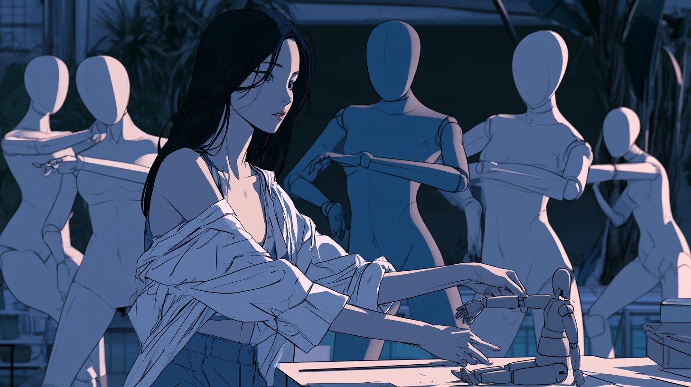
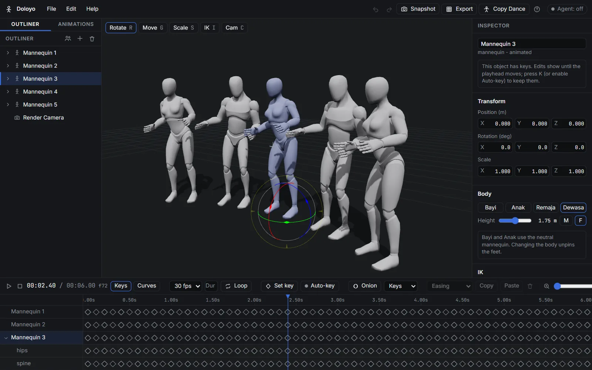
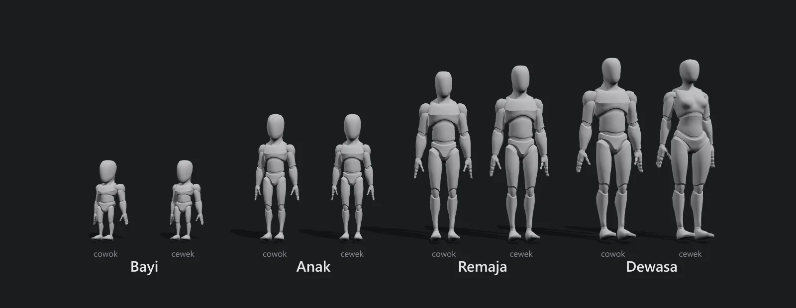
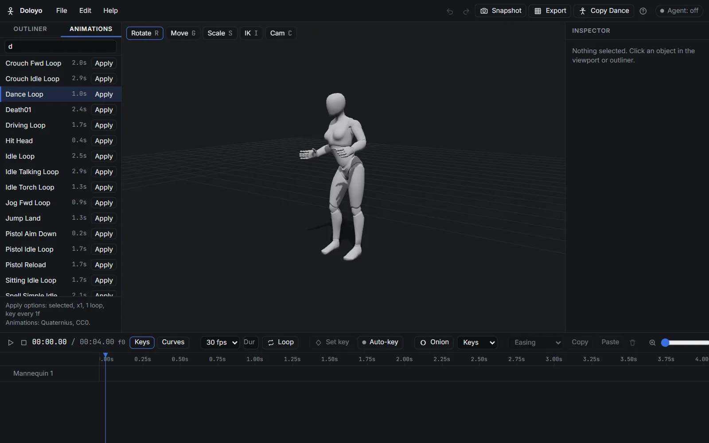
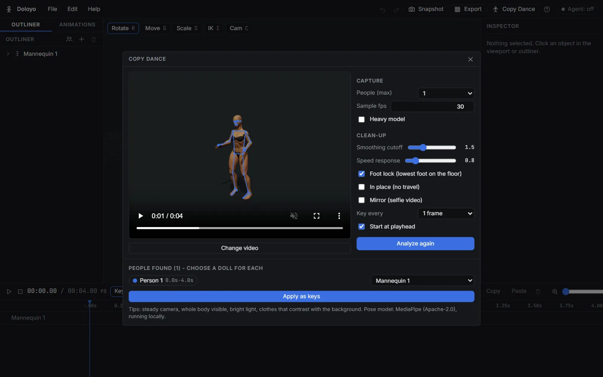
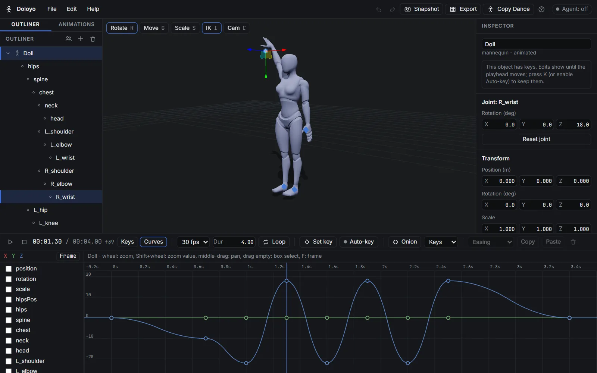
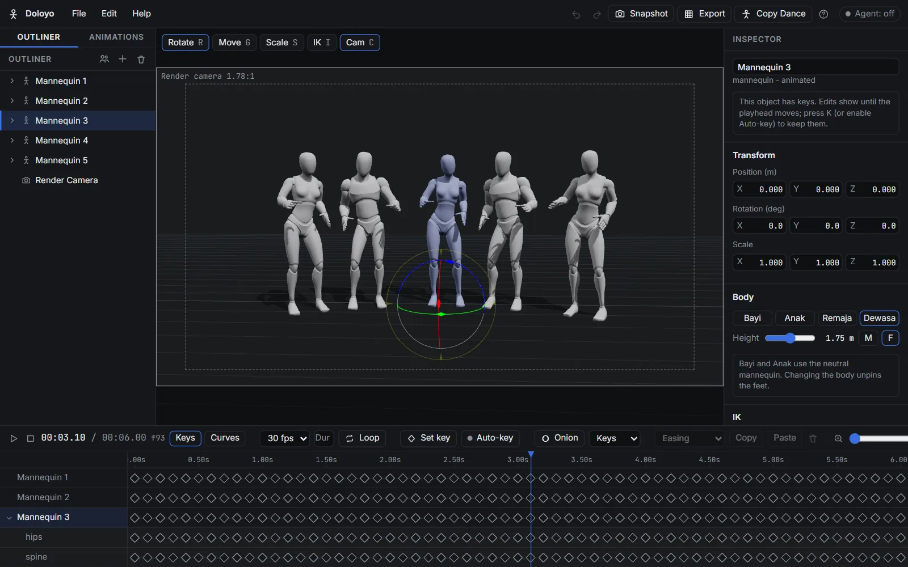
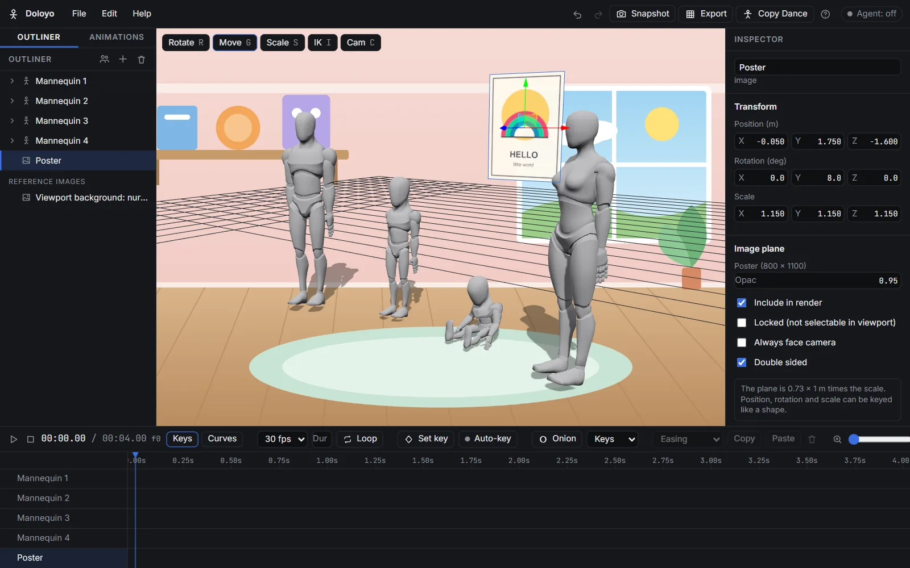
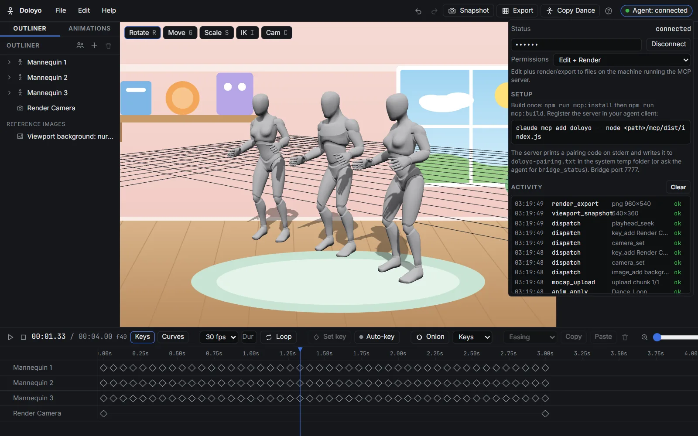

<p align="center">
  
</p>

# Doloyo

**Your floppy little motion studio.** Pose a 3D mannequin, keyframe it, copy a dance from a video and export the result. It runs in your browser, and AI agents can drive it through a local MCP server.

English | [Bahasa Indonesia](README.id.md)

[](https://github.com/dkfadhila/doloyo/actions/workflows/ci.yml)
[](LICENSE)

<p align="center">
  
</p>

## Try it

- **In the browser:** https://doloyo.vercel.app. Nothing to install; rendering uses your own GPU and projects stay in your browser.
- **Run locally** (works fully offline):

```
git clone https://github.com/dkfadhila/doloyo
cd doloyo
npm run setup        # npm install, build the MCP server, download the pose model
npm start            # http://localhost:5173
```

First steps: click a joint, drag the ring to rotate it (R), move the playhead, pose again, press K to set a key, Space plays. Help > Examples loads ready projects and Help > Tour walks through the app.

## Features

### Posing and keyframes

*The editor (screenshot at the top): outliner on the left, the viewport with a rotate gizmo on the selected doll, the inspector on the right and the keyframe timeline below. Every change is an undoable command, whether it came from you or from an agent.*

- Procedural 17-joint mannequin with joint limits, plus cube, sphere and cylinder; many objects per scene.
- FK posing with a gizmo, mirror, pose library, onion skin, per-joint keys with named or bezier easing, marquee and multi-key edit, loop, fps and duration.
- Scene presets for duo, trio, group of 5 and a family (2 adults, child, baby), mixed gender by default.

### Characters and body sizes



*The eight built-in body variants: Baby, Child, Teen and Adult, each male and female. Children are neutral art mannequins; only proportions change. IK, foot pins and exports follow the body.*

- Body sizes with a height slider and baby poses (sitting, crawling, standing and holding on) that keep the body on the floor.
- Quaternius mannequins and superheroes (CC0), or your own `.glb` / `.vrm` file with bone mapping. Every character is just another view of the same 17-joint pose.

### Animation library



*The Animations tab holds 86 CC0 clips. Hover or click a clip to preview it on the selected doll; Apply bakes it as keys in one undo step.*

- Target, speed, loops, mirror and in-place options; clips work on every character and body size.

### Copy Dance: video to animation



*Copy Dance tracks the people in a video with MediaPipe Pose Landmarker and turns them into keys. The blue skeleton is the tracked pose; here the source clip was rendered from Doloyo itself.*

- Up to 4 people, smoothing, foot lock, in-place and mirror options. It runs entirely in your browser; the video is never uploaded.

### IK, foot pins and curves



*IK handles on the wrists and ankles (blue) let you drag a limb to a point. Below, the curve editor edits a joint channel with bezier handles.*

- Two-bone IK with pole control, foot pins that stop sliding while the hips move, and Bake pins to turn the result into plain keys.

### Render camera



*Looking through the animated render camera (C). The dimmed border is outside the frame and the dashed rectangle is the 90% safe area for the export aspect.*

- PNG (720p to 4K, transparent), PNG sequence (zip), WebM and MP4 through WebCodecs, GLB and BVH with baked animation for Blender, Unity or Unreal.

### Reference images



*A room picture used as the viewport background and a poster added as an image plane. The selected plane has its own gizmo and options in the inspector.*

- Three modes, like Blender: a screen-space **viewport background** (fit, fill or center, opacity), an **image plane** in the 3D scene (move, rotate, scale, keyframes, opacity, double sided, lock, always face camera) and a **camera background** locked to the render camera frame.
- Add them from File > Add reference image, the outliner + menu, or by dropping a file on the viewport (png, jpg, webp, gif first frame, svg).
- "Include in render" decides whether a picture shows up in snapshots, exports and GLB (image planes become textured quads). Pictures are stored in your browser; the project file references them by id, and an "Embed images" option on save packs images up to 2 MB into the file.

### Agent control



*An MCP client connected through the Agent panel (the pairing code is hidden here). The activity log lists what the agent did; the tab shows it live and you can undo it.*

- The MCP server exposes the same commands as the UI (scene, objects, joints, keys, IK, camera, animations, Copy Dance, reference images, export) with read-only, edit or edit + render permissions.

## Agent control (MCP)

The agent talks MCP over stdio to `doloyo-mcp`, which runs a WebSocket bridge on `127.0.0.1:7777`. The Doloyo tab connects to it with a 6-digit pairing code. The npm package is **not published**, so the server runs from a clone (`npm run setup` builds it):

```
claude mcp add doloyo -- node <path>/mcp/dist/index.js
```

Claude Desktop (`claude_desktop_config.json`) or any stdio MCP client:

```json
{
  "mcpServers": {
    "doloyo": {
      "command": "node",
      "args": ["<path>/mcp/dist/index.js"]
    }
  }
}
```

To drive the hosted app at https://doloyo.vercel.app, add `--allow-hosted` to the arguments. The hosted page then connects to `ws://127.0.0.1:7777` on your computer; Chrome and Edge may show a Private Network Access prompt, and Safari blocks the connection (use the local app there).

Then open the app, click the **Agent** pill (top right), enter the code the server prints (or let the agent read it from `bridge_status`) and choose a permission mode.

- [AGENTS.md](AGENTS.md): step-by-step tutorial for agents with worked examples (wave, dance crew with a camera move, a baby commercial scene, Copy Dance, IK).
- [docs/AGENT.md](docs/AGENT.md): the full tool and command reference.
- [mcp/README.md](mcp/README.md): server options, security model and troubleshooting.

## Privacy

Everything runs locally. Projects are stored in your browser (IndexedDB) or in files you save. Videos used for Copy Dance, reference images and imported characters are never uploaded. The only network requests are the page and its static assets, Google Fonts and, when the app was deployed without the bundled pose model, the pinned MediaPipe runtime from jsDelivr and the model file from Google storage (the Copy Dance dialog says so). The MCP bridge binds to 127.0.0.1 and only accepts allow-listed browser origins plus the pairing code. No analytics.

## Tech stack

TypeScript, React 18, Vite, three.js with React Three Fiber and drei, zustand, three-vrm, MediaPipe Tasks Vision (pose), WebCodecs with mp4-muxer and webm-muxer, fflate, and the Model Context Protocol SDK for the agent server. The project state is plain JSON changed only through invertible commands (`src/core`), which is what makes undo, agents and tests simple. Vitest covers the core, retargeting, exports, the MCP bridge (smoke test) and the tutorial in AGENTS.md.

```
npm test                       # vitest
npm run build                  # tsc --noEmit + vite build
npm run smoke --prefix mcp     # MCP bridge smoke test
npm run examples               # regenerate public/examples/*.mdoll.json from the command API
```

Static hosting: `VITE_BASE=/sub/path/ npm run build` produces a host-agnostic `dist/`. Configs for Vercel, Netlify and Cloudflare Pages are included. See [CONTRIBUTING.md](CONTRIBUTING.md).

Project files keep the `.mdoll.json` extension (Doloyo was called Motion Doll Studio before 0.6); older files, saved projects and imported characters carry over.

## Roadmap

Done: posing and keyframes, agent bridge, export, characters and retargeting, animation library, Copy Dance, IK, curve editor, render camera, GLB and BVH, body sizes, reference images. Next, pending decisions: publish `doloyo-mcp` to npm, tag 1.0. Ideas after that: spine and multi-bone IK, face and hand tracking, more import formats.

## Credits and licenses

Doloyo is MIT, see [LICENSE](LICENSE). Characters and animations by [Quaternius](https://quaternius.com) (CC0). Pose model: MediaPipe (Apache-2.0). Built on three.js, React Three Fiber, drei, three-vrm, fflate, webm-muxer, mp4-muxer and the MCP SDK (all MIT). Full list: [THIRD_PARTY_NOTICES.md](THIRD_PARTY_NOTICES.md) and [public/assets/CREDITS.md](public/assets/CREDITS.md). Changes: [CHANGELOG.md](CHANGELOG.md).

## Why Doloyo?

Honest answer: no serious reason. Doloyo is a side project made for fun, and it shows.

It is not the best tool for anything. If you need real animation work, use a proper 3D or animation package; they are far more capable and far more polished. Doloyo is for when you just want to throw a few floppy dolls on screen, make them dance, and maybe let an AI agent push them around, all in a browser tab.

What you get:

- Opens in a browser, nothing to install for the web app, renders on your own machine.
- Keyframes, IK, a curve editor, an animation library and Copy Dance from a video.
- A built-in MCP server so an agent can pose and animate for you.

What you also get (the not so good part):

- It is not a real 3D suite: no modeling, no sculpting, no fancy renderer.
- One humanoid rig with 17 joints: no fingers, no face.
- Copy Dance is webcam-grade: fast moves, hidden limbs and moving cameras confuse it, so expect cleanup.
- No physics. Feet slide sometimes. Dolls clip into each other.
- The hosted agent connection does not work in Safari.
- Imported characters and reference images stay in the browser that imported them.
- Mostly tested in Chrome by one person. Expect bugs, and please report them.

If that still sounds fun, welcome. If not, no hard feelings.
